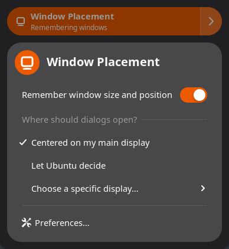

# Ubuntu Window Spawner

Move an app to the display you want, resize it, and close it. The next time you open it, Ubuntu Window Spawner restores its position and size. Dialogs can have a home of their own. For example, an app on a side display can ask for administrator approval in the center of your main display.

Built for Ubuntu 26.04 with GNOME Shell 50 on Wayland. It handles both native Wayland and XWayland windows. It runs as a per-user Shell extension and works on its own.



## Install or update

Run this from the repository root as your desktop user, then log out and back in.

```sh
./install.sh
```

The installer checks the GNOME Shell version and registers the extension. Updates preserve your settings, saved positions, and enabled or disabled choice. If user extensions are turned off globally, turn them on in the Extensions app.

To uninstall, run the following command from the same checkout.

```sh
./uninstall.sh
```

Uninstall removes the tile, extension files, preferences, and all remembered positions. A fresh install starts empty. To temporarily return to Ubuntu's usual window placement and keep your saved positions, turn off **Ubuntu Window Spawner** in the Extensions app.

## Choose where windows open

Open the **system menu** next to the sound and power icons, then expand **Window Placement** using its arrow. The menu follows your panel if you use a bottom taskbar.

| Setting | What it does |
| --- | --- |
| **Remember window size and position** | Learns where you use each app and restores it when you open another window. On by default. |
| **Centered on my main display** | Centers supported dialogs on the display marked primary in Ubuntu's Displays settings. This is the default. |
| **Choose a specific display…** | Picks a connected display by name. Your main display takes over temporarily if you unplug it. |
| **Let Ubuntu decide** | Uses normal desktop behavior for dialogs. |
| **Preferences…** | Lets an individual app manage its own window placement or forgets where it was last used. |

The tile's main switch controls window memory. Its arrow also gives you the dialog controls, including when window memory is off.

## What gets remembered

- The most recently active main window supplies the next placement for that app. Opening a dialog leaves the main window's saved position intact.
- Maximized windows reopen maximized. When a normal size was previously recorded, unmaximizing returns the window to it.
- Display positions use the usable area reported by GNOME, including space reserved for panels. Connecting and disconnecting displays gives each combination of display connectors its own saved placements.
- On a new display combination, the extension uses the last known placement as a starting point. If the original display is missing, the window opens on the primary display. App-enforced minimum sizes still apply.
- **Forget** clears an app's positions across display layouts. Its currently open windows stop contributing to that record. Opening a new window starts learning again.

Movable application dialogs and GNOME Shell modal prompts, including the administrator prompt, follow the dialog setting. GNOME keeps attached sheets with their parent window. Menus, tooltips, and popovers stay anchored to their controls.

Window records are stored locally under `$XDG_STATE_HOME/ubuntu-window-spawner` (normally `~/.local/state/ubuntu-window-spawner`). They contain app identifiers, display connectors, and geometry. Window titles, document paths, and prompt contents are never recorded.

## Using other desktop extensions

Ubuntu Window Spawner reads the window's final frame and leaves subsequent moves and resizes to the desktop. With UbuntuWindowSnapping, you can snap a window, close it, reopen it in the snapped rectangle, and snap it again. Quick Settings uses GNOME's own menu widgets so themes such as Nightfall can style them. With a Dash to Panel taskbar, restored windows fit above the panel even when its height changes. The UbuntuThermals indicator can share that panel. None of these companions is required.

## Verify after login

1. Open a resizable app. Move it to a second display, resize it, close it, and reopen it. Check the display, size, and position.
2. Maximize the window, close it, reopen it, then unmaximize. Check that its earlier size returns.
3. Start an action that opens an authentication prompt. Confirm the prompt appears on the chosen display, then cancel it.
4. Choose **Let Ubuntu decide** and open the prompt again. GNOME should use its normal placement.
5. Run `./uninstall.sh` and reopen the system menu. The tile should be gone. Reinstalling should start with no saved positions.

## Tests

Run the focused checks from the repository root.

```sh
gjs -m tests/placement.test.js
gjs -m tests/shell-dialogs.test.js
./tests/install.test.sh
```

These check geometry, state persistence, forgetting, prompt placement, and install/update/removal using temporary data.

For an end-to-end check, the desktop test starts a private GNOME Shell 50 session with two virtual monitors. It installs the extension, opens Wayland and XWayland clients, exercises the Shell prompt with a synthetic request, disables and re-enables the extension, and uninstalls it while Shell is running. The test uses its own settings database and temporary files.

```sh
./tests/desktop.sh
```

To repeat with UbuntuWindowSnapping and Nightfall, pass their checkout directories. The optional test also needs Ubuntu Tiling Assistant installed.

```sh
./tests/desktop.sh --companions ../UbuntuWindowSnapping ../UbuntuNightFall
```
